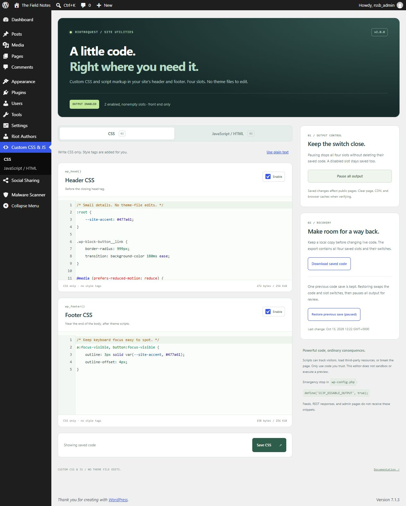
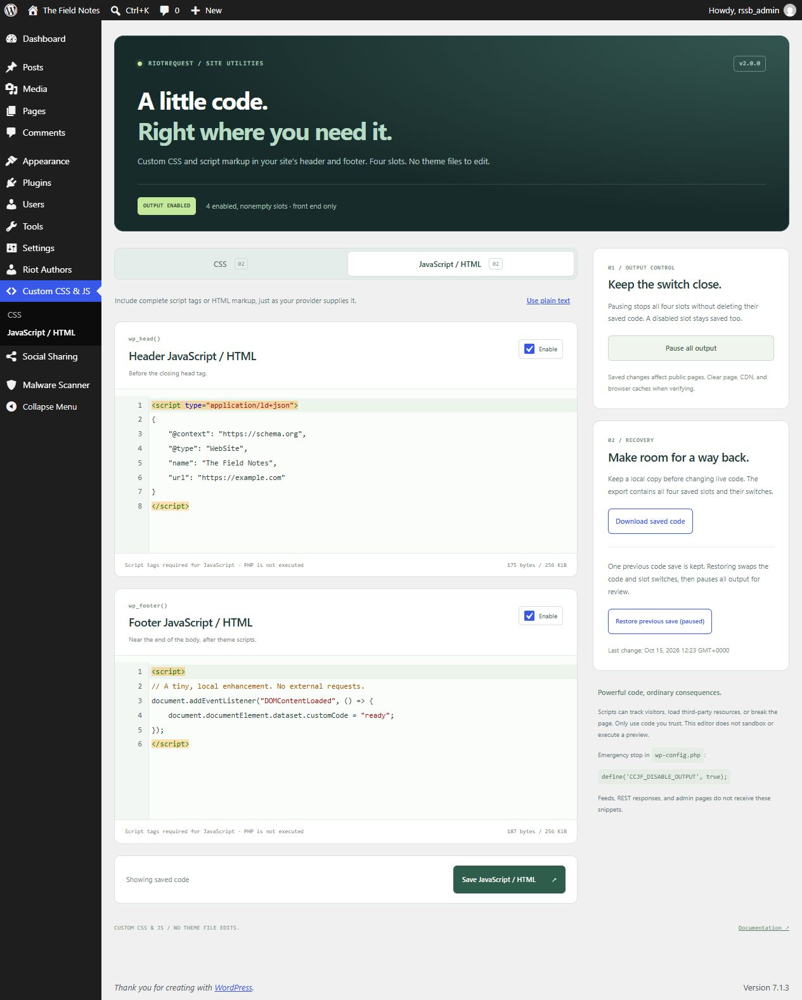

# Custom CSS & JS for Headers and Footers

**A little code. Right where you need it.**

Four code slots in the WordPress dashboard: header CSS, footer CSS, header JavaScript / HTML, and footer JavaScript / HTML. Add the code you need without editing a theme or installing a snippet marketplace.

Version **2.0.0** keeps the original plugin's small scope and adds a proper editor, output controls, and a way back from a bad save.



## Four slots. A few useful controls.

| Feature | What it does |
| --- | --- |
| **Header and footer CSS** | Wraps your CSS in style tags. CSS values, quotes, backslashes, and angle brackets are preserved. |
| **Header and footer JavaScript / HTML** | Outputs complete script tags or markup exactly as saved by an authorized user. Supports inline scripts, module scripts, JSON-LD, and provider-supplied HTML. |
| **Native code editor** | Uses WordPress's bundled CodeMirror editor for highlighting and line numbers. No editor library is downloaded from a third party. |
| **Per-slot switches** | Disable a slot while keeping its saved code. |
| **Master pause** | Stop all four slots without clearing them. Resume enabled, nonempty slots when ready. |
| **One previous code save** | Restore the previous four-slot snapshot and slot switches. Restoration pauses output for review and keeps the replaced code as the new previous save. |
| **Download saved code** | Exports the four saved slots and switches as JSON. |
| **Stale-save protection** | Rejects a save from an older tab rather than overwriting newer settings. Concurrent writes compare the stored revision before replacing it. |

No build step, new JavaScript framework, external fonts, premium tiers, PHP execution, or automatic minification. The plugin's editor assets load only on its own admin pages. Visitor pages receive your enabled snippets, without an extra plugin stylesheet or script bundle.

## Install

Requires **WordPress 6.3+**, **PHP 7.4+**, and both the `manage_options` and `unfiltered_html` capabilities. Use a maintained PHP version.

1. Place the plugin files in `wp-content/plugins/custom-css-js/`, keeping `header-footer-includer.php`, `editor.css`, and `editor.js` together.
2. Activate **Custom CSS & JS for Headers and Footers**.
3. Open **Custom CSS & JS** in the WordPress admin.
4. Choose **CSS** or **JavaScript / HTML**, edit the header/footer fields, and save that tab.
5. Check an actual front-end page and clear page/CDN/browser caches when verifying changes.

Saving one tab preserves the other tab's code. The **Enable** checkbox controls whether that slot is emitted; it does not delete the text.

## What goes in each field

### CSS: no style tags

```css
:root {
    --site-accent: #477a61;
}

.wp-block-button__link {
    border-radius: 999px;
}
```

Style tags are added automatically. Opening or closing style tags inside a CSS field are rejected because they can break out of the generated wrapper. If you need to represent that sequence inside a CSS string, use CSS escapes instead. This is not a full CSS parser or a guarantee that the stylesheet is correct.

Header CSS is generally the best place for visible styles. Footer CSS arrives later and can cause a flash while a page renders.

### JavaScript / HTML: include script tags

```html
<script>
document.addEventListener('DOMContentLoaded', () => {
    document.documentElement.dataset.customCode = 'ready';
});
</script>
```

Keep the complete markup your provider supplies, including any required `type`, `src`, `async`, or `defer` attributes. The plugin does not add a script wrapper or alter execution timing. Plain JavaScript without script tags will be emitted as text, not automatically executed. PHP in a field is never evaluated by the server.



The screenshots show harmless demonstration code on a disposable WordPress installation. No analytics or third-party scripts were loaded for these captures.

## Editor behavior

- The code editor uses syntax highlighting; it does **not** sandbox, run a preview, or certify your code as valid.
- Select **Use plain text** to return to ordinary textareas without losing edits. WordPress's profile-level syntax-highlighting preference is respected too.
- **Ctrl+S / Cmd+S** saves the current tab. A byte counter and unsaved-change indicator help track edits; the browser warns before leaving unsaved edits when supported.
- Native forms and textareas work without JavaScript. Source is escaped in the dashboard so pasted code cannot execute there.
- Each field accepts at most **256 KiB** and rejects NUL bytes or malformed array input. A rejected save does not truncate or partially save code.

If another tab saves first, copy your unsaved text and reload the saved version before continuing. A rejected form keeps its submitted text visible and escaped. It does not silently replace the newer revision.

## Recovery and pause

**Pause all output** stops newly generated front-end output immediately while retaining saved code. Cached pages may still contain older snippets until caches are purged. This is not an emergency override for third-party caches or a browser script already running.

**Download saved code** produces an authenticated JSON download containing all four **saved** slots, enable switches, and the master pause setting. It does not include unsaved browser edits or previous-save history. Treat exports as sensitive if your snippets contain tokens or private configuration. There is no one-click import: review the JSON and copy the desired code back into its fields.

**Restore previous save (paused)** swaps the last code snapshot and slot switches back into the editor, then pauses **all** output. Review both tabs before choosing **Resume enabled slots**. Saving code or changing slot switches replaces the one previous code snapshot; pausing and resuming do not consume it. This is a convenience, not a full revision history or an independent database backup.

If you cannot reach the editor, add this before WordPress loads in `wp-config.php`:

```php
define('CCJF_DISABLE_OUTPUT', true);
```

The constant suppresses every plugin slot without deleting saved settings. Remove it only after reviewing the saved code. `DISALLOW_UNFILTERED_HTML` also suppresses plugin output and prevents editor access through WordPress's capability policy.

## Where code runs

Enabled, nonempty CSS and JavaScript / HTML are output through `wp_head` and `wp_footer` at priority 99, with CSS before markup in each location. The plugin does not inject snippets into admin pages, feeds, or REST responses. Saved code can appear in normal front-end previews; unsaved editor text is never previewed.

Your theme must call the standard WordPress head and footer hooks. Hook priority does not guarantee ordering relative to every other plugin, and snippets are not automatically enrolled in WordPress's script dependency system. Existing CSP restrictions can block inline scripts or styles; the plugin does not weaken CSP, obtain consent, or manage third-party loading policies for you.

These are **site-wide, trusted code fields**. Saved scripts can load external resources, track visitors, or change/break public pages. Use code you understand and test on staging. The plugin intentionally preserves authorized executable markup instead of stripping it and pretending the result still works.

## Permissions and multisite

Both `manage_options` and `unfiltered_html` are required to view, save, restore, pause/resume, or export snippets. Writes and exports require POST and WordPress nonces. Subscriber/editor access alone is insufficient. On multisite, WordPress normally restricts unfiltered HTML to super administrators; each site's settings are stored independently. No network-wide snippet manager is added.

Administrator access by itself does not override `DISALLOW_UNFILTERED_HTML` or other capability restrictions. An emergency output-disable constant does not grant permission to edit code.

## Upgrading from v1.1

Back up the database, then replace the plugin files in the **existing directory**. Keep `header-footer-includer.php` as the entry point and avoid activating two copies.

The four original `custom_css_js_plugin_css_head`, `css_foot`, `js_head`, and `js_foot` option values are read without alteration until the first successful v2 save. That save creates one versioned settings option, `custom_css_js_plugin_v2`, with the previous code snapshot. Original option values stay untouched as upgrade backups; v2 becomes the active source of truth after that point.

The old JavaScript save path stripped script tags. The upgrade preserves what is currently stored, but cannot recover code already removed by the old sanitizer. Restore damaged snippets from your original source or database backup. Invalid legacy CSS containing style tags remains available for editing/export but is not emitted into a style wrapper.

Old integrations reading the v1 option keys will continue to see the retained v1 values. New v2 edits do not sync backwards to those backup keys. Deactivation stops output and retains settings; deleting the plugin files does not automatically remove its saved options. There is no destructive uninstall routine.

## Development

No package installation is needed:

```sh
php -l header-footer-includer.php
node --check editor.js
```

For integration checks, activate the plugin on a **disposable WordPress installation**, add `define('CCJF_TESTING', true);` to that test site's configuration before WordPress loads, and run:

```sh
php test-integration.php /path/to/disposable-wordpress/wp-load.php
```

The checks temporarily replace snippet settings, create restricted test users, exercise forms/exports in subprocesses, and restore the original options. **Do not run them on a production site.**

For v2.0.0, **46 checks passed on each of WordPress 6.3 and 7.1.3**, using PHP 8.2.12 on Windows. Coverage includes legacy preservation, exact script source round trips, partial/oversized/malformed input, CSS wrapper containment, stale forms, pause/restore, output-disable constants, capability and nonce restrictions, export, escaped editor source, and the plain-text preference. PHP lint and JavaScript syntax checks passed too.
